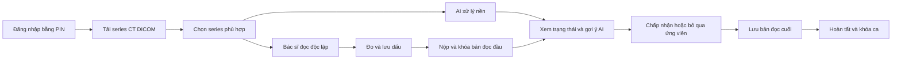
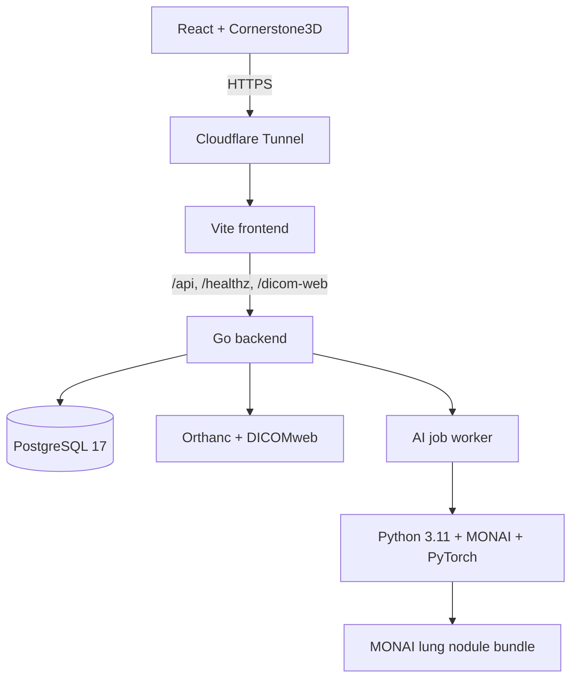

# Hệ thống hỗ trợ bác sĩ phát hiện nốt phổi trên ảnh CT

> **Đồ án cơ sở — Proof of Concept (POC) phục vụ nghiên cứu và học tập**  
> Hệ thống không phải thiết bị y tế, không dùng để chẩn đoán và không thay thế quyết định của bác sĩ.

## 1. Giới thiệu

Nốt phổi trên ảnh CT có thể nhỏ, xuất hiện trên nhiều lát cắt và dễ bị bỏ sót khi khối lượng dữ liệu lớn.
Đồ án xây dựng một hệ thống web hỗ trợ quy trình đọc CT lồng ngực theo mô hình **second reader**:
bác sĩ đọc ca độc lập trước, sau đó mới xem gợi ý từ mô hình AI và tự đưa ra kết luận cuối cùng.

Mục tiêu của POC là minh họa khả năng tích hợp dữ liệu DICOM, trình xem ảnh CT, quy trình đọc độc lập,
mô hình phát hiện nốt phổi và lưu vết kết quả trong một hệ thống hoàn chỉnh. Kết quả AI chỉ mang tính hỗ
trợ nghiên cứu; bác sĩ luôn giữ quyền quyết định cuối cùng.

## 2. Mục tiêu đồ án

- Xây dựng luồng nhập và quản lý một series CT ở định dạng DICOM.
- Hiển thị chuỗi ảnh CT trục ngang trực tiếp trên trình duyệt.
- Cho phép bác sĩ đánh dấu, đo và lưu các vị trí nghi ngờ trước khi xem AI.
- Khóa bản đọc độc lập để bảo đảm kết quả ban đầu không bị sửa sau khi AI được tiết lộ.
- Chạy mô hình MONAI ở tiến trình nền và lưu trạng thái công việc AI tách biệt với bản đọc của bác sĩ.
- Cho phép bác sĩ xem xét gợi ý AI, lưu bản đọc cuối và hoàn tất ca ngay cả khi AI thất bại.
- Bảo vệ dữ liệu bằng đăng nhập PIN, phiên làm việc, phân quyền sở hữu ca và các ràng buộc ở cơ sở dữ liệu.

## 3. Phạm vi hiện tại

### Đã triển khai

- Đăng nhập bằng PIN 8 chữ số; phiên đăng nhập dùng cookie `HttpOnly`, `SameSite=Strict`.
- Tải lên file `.dcm`, file DICOM không đuôi, thư mục lồng nhau và ZIP/TAR/TAR.GZ.
- Kiểm tra series CT phù hợp trước khi tạo ca; bỏ qua `DICOMDIR`, `.DS_Store`, `Thumbs.db` và `__MACOSX`.
- Lưu trữ và cung cấp ảnh qua Orthanc/DICOMweb; trình duyệt không truy cập Orthanc trực tiếp.
- Dashboard liệt kê các ca thuộc tài khoản đang đăng nhập.
- Viewer CT axial bằng Cornerstone3D: đổi lát cắt, window/level, zoom và đo nốt.
- Quy trình ba bước: **Đọc độc lập → Xem gợi ý AI → Chốt ca**.
- Tự động lưu bản nháp, khóa bản đọc đầu, lưu quyết định với ứng viên AI và khóa bản cuối.
- Worker AI chạy tuần tự trong backend, gọi Python/MONAI và ghi nhận trạng thái `queued`, `running`,
  `succeeded` hoặc `failed`.
- Health check cho backend, PostgreSQL và Orthanc.
- Cloudflare Tunnel có thể dùng để công bố giao diện HTTPS mà không mở trực tiếp cổng ứng dụng.

### Chưa thuộc phạm vi hoàn chỉnh

- Chưa có xác nhận hoặc ký báo cáo lâm sàng.
- Chưa hỗ trợ nhiều bác sĩ cùng đọc độc lập một ca; mỗi ca hiện thuộc một tài khoản.
- Chưa hiển thị glyph ứng viên AI trực tiếp chồng lên ảnh; chức năng “Xem lát” chỉ điều hướng tới lát gần nhất.
- Chưa đánh giá độ chính xác lâm sàng trên tập kiểm thử độc lập.
- Chưa hỗ trợ NIfTI, NRRD, MetaImage, ảnh thông thường, RAR/7z, archive lồng nhau hoặc tải dữ liệu từ URL.
- Docker Compose hiện chỉ là đường đóng gói phụ và chưa chứa đầy đủ runtime AI.

## 4. Quy trình nghiệp vụ



AI không được tiết lộ trước khi bản đọc đầu bị khóa. Nếu AI đang chờ, đang chạy hoặc thất bại, bác sĩ
vẫn có thể hoàn tất ca bằng kết quả đọc của mình.

## 5. Kiến trúc hệ thống



Backend được tổ chức theo nguyên tắc Clean Architecture với dependency injection thủ công:

- **Transport:** HTTP router, xác thực, DTO và ánh xạ lỗi.
- **Application:** nhập ca, bản đọc đầu, bản đọc cuối, công việc AI và quản lý phiên.
- **Infrastructure:** PostgreSQL, Orthanc, filesystem và tiến trình Python.
- **Frontend:** React quản lý trạng thái cục bộ; Cornerstone3D hiển thị và thao tác ảnh DICOM.

## 6. Công nghệ sử dụng

| Thành phần | Công nghệ |
| --- | --- |
| Frontend | React 19, TypeScript 5.9, Vite 8, Cornerstone3D 4.22 |
| Backend | Go 1.27, chi, pgx |
| Cơ sở dữ liệu | PostgreSQL 17 |
| DICOM server | Orthanc 1.13, DICOMweb plugin |
| AI và xử lý ảnh | Python 3.11, MONAI 1.4, PyTorch 2.4, SimpleITK, pydicom |
| Mô hình | MONAI Bundle `lung_nodule_ct_detection` 0.6.11 |
| Triển khai | systemd, Cloudflare Tunnel; Docker Compose là tùy chọn phụ |

## 7. Cấu trúc thư mục

```text
.
├── backend/       # Go API, migration, userctl và worker AI
├── frontend/      # React UI, DICOM viewer và kiểm thử frontend
├── services/      # Python package, kiểm tra hình học và MONAI bundle
├── infra/         # Cấu hình Orthanc và Docker Compose tùy chọn
├── docs/          # Thiết kế, runbook và bằng chứng kiểm thử
├── plans/         # Kế hoạch triển khai theo từng hạng mục
├── backlogs/      # Backlog và tiêu chí nghiệm thu
└── action_logs/   # Báo cáo thay đổi đã hoàn thành
```

## 8. Yêu cầu môi trường

Môi trường native được ưu tiên cho bản demo đầy đủ:

- Ubuntu 22.04 hoặc hệ điều hành tương đương.
- Go 1.27, Node.js 24 và Python 3.11.
- PostgreSQL 17 và Orthanc có plugin DICOMweb.
- GPU NVIDIA phù hợp nếu chạy suy luận CUDA; có thể cấu hình thiết bị bằng `AI_DEVICE`.
- Tối thiểu khoảng 16 GB RAM và đủ dung lượng cho dữ liệu CT, model, PostgreSQL và Orthanc.

Không đưa dữ liệu DICOM có thông tin định danh bệnh nhân, PIN, mật khẩu, pepper, token hoặc model có
điều kiện bản quyền vào Git.

## 9. Cài đặt và chạy native

Phần này tóm tắt cách chạy dành cho phát triển. Quy trình dựng máy chi tiết được ghi trong
[`docs/lc1-18-native-runtime.md`](docs/lc1-18-native-runtime.md).

### 9.1. Clone mã nguồn

```bash
git clone https://gitlab.com/tien-group3751441/do-an.git
cd do-an
```

### 9.2. Chuẩn bị PostgreSQL và Orthanc

1. Tạo database `nodule` bằng tài khoản owner và một role riêng cho ứng dụng.
2. Chạy Orthanc với xác thực, DICOMweb, persistent storage và `OverwriteInstances=false`.
3. Giữ PostgreSQL, Orthanc và backend trong mạng nội bộ; trình duyệt chỉ đi qua backend.

Chạy migration bằng thông tin tài khoản owner:

```bash
cd backend
go run ./cmd/migrate up
go run ./cmd/migrate version
```

Phiên bản migration mong đợi hiện tại là `5`.

### 9.3. Chuẩn bị môi trường AI

Tạo virtual environment Python 3.11, cài đúng phiên bản PyTorch cho CPU/CUDA của máy, sau đó cài các
dependency được khai báo trong [`services/pyproject.toml`](services/pyproject.toml) và package `services`.
Các bước kiểm tra môi trường và model nằm tại
[`docs/lc1-03-monai-environment.md`](docs/lc1-03-monai-environment.md) và
[`docs/lc1-06-step-zero-gate.md`](docs/lc1-06-step-zero-gate.md).

### 9.4. Cấu hình backend

Backend chỉ đọc biến môi trường, không tự động đọc file `.env`:

```text
HTTP_ADDR=127.0.0.1:8080
POSTGRES_HOST=127.0.0.1
POSTGRES_PORT=5432
POSTGRES_DB=nodule
POSTGRES_USER=<application-role>
POSTGRES_PASSWORD=<secret>
ORTHANC_URL=http://127.0.0.1:8042
ORTHANC_USER=<secret>
ORTHANC_PASSWORD=<secret>
AI_PYTHON=<absolute-path-to-python>
AI_BUNDLE_DIR=<absolute-path-to-monai-bundle>
AI_JOB_DIR=<private-job-directory>
AI_DEVICE=cuda
AI_TIMEOUT=15m
UPLOAD_DIR=<private-upload-directory>
AUTH_PIN_PEPPER=<32-random-bytes-as-unpadded-base64url>
AUTH_COOKIE_SECURE=false
```

Đặt `AUTH_COOKIE_SECURE=true` khi chạy sau HTTPS. Không thay `AUTH_PIN_PEPPER` sau khi đã tạo người dùng,
vì mọi PIN cũ sẽ không còn tra cứu được.

Build và chạy backend:

```bash
cd backend
mkdir -p ../bin
go build -o ../bin/ ./cmd/...
../bin/server
```

### 9.5. Tạo tài khoản đăng nhập

Trong shell đã nạp cùng cấu hình PostgreSQL và `AUTH_PIN_PEPPER` với backend:

```bash
./bin/userctl create --name "Bác sĩ Demo"
```

PIN chỉ được in một lần. Không commit hoặc ghi PIN vào tài liệu công khai.

### 9.6. Chạy frontend

```bash
cd frontend
npm ci
BACKEND_URL=http://127.0.0.1:8080 npm run dev -- --host 127.0.0.1
```

Mở <http://127.0.0.1:5173>, đăng nhập bằng PIN và kiểm tra mục **Chẩn đoán kết nối**. PostgreSQL,
Orthanc và backend phải cùng báo trạng thái hoạt động.

## 10. Kịch bản demo

1. Đăng nhập bằng PIN của một tài khoản bác sĩ.
2. Chọn một thư mục hoặc archive chứa đúng một series CT DICOM phù hợp.
3. Tải lên, kiểm tra thông tin series và chọn **Mở ca**.
4. Duyệt các lát cắt; dùng công cụ đo để tạo dấu nghi ngờ và lưu bản nháp.
5. Chọn **Nộp và khóa** để kết thúc giai đoạn đọc độc lập.
6. Tải lại ca, xem trạng thái/gợi ý AI và ghi nhận quyết định với từng ứng viên nếu có.
7. Lưu bản cuối, chọn **Hoàn tất ca** và kiểm tra giao diện chỉ đọc.

Dữ liệu tham khảo và quy trình chuẩn bị ca LIDC-IDRI được mô tả tại
[`docs/lc1-02-data-reference.md`](docs/lc1-02-data-reference.md).

## 11. Kiểm thử

### Backend

```bash
cd backend
go build ./...
go vet ./...
go test ./...
```

Một số integration test PostgreSQL chỉ chạy khi cung cấp DSN thử nghiệm riêng. Không chạy chúng trên
database chứa dữ liệu demo cần giữ lại.

### Frontend

```bash
cd frontend
npm run test:auth
npm run test:geometry
npm run test:initialread
npm run test:upload
npm run build
```

### Python

```bash
cd services
python -m unittest discover -s tests
```

Kiểm thử đơn vị và build chỉ chứng minh hợp đồng phần mềm. Độ chính xác phát hiện, thời gian suy luận,
RAM/VRAM và vị trí ứng viên phải được đo bằng một lần chạy model thật trên môi trường phù hợp.

## 12. An toàn, bảo mật và quyền riêng tư

- AI bị che trước khi bác sĩ khóa bản đọc độc lập.
- Bản đọc đã khóa được bảo vệ ở cả API và PostgreSQL trigger.
- Mỗi ca hiện chỉ thuộc một người dùng; tài khoản khác không thể mở hoặc sửa ca đó.
- Credential của Orthanc và PostgreSQL chỉ nằm ở backend.
- Upload archive có giới hạn kích thước/số file và chặn path traversal, link, archive lồng nhau.
- DICOM dùng cho demo phải được khử định danh; không công khai UID hoặc ảnh có thông tin bệnh nhân.
- Cloudflare Tunnel chỉ chuyển tiếp frontend; backend và các dịch vụ dữ liệu vẫn nên nghe trên loopback
  hoặc được chặn bằng firewall.

## 13. Hạn chế và hướng phát triển

- Bổ sung mô hình phân công một ca cho nhiều bác sĩ và tách riêng từng bản đọc độc lập.
- Hiển thị candidate glyph của AI trực tiếp trên viewer sau khi hoàn thành kiểm chứng tọa độ.
- Đánh giá model trên tập dữ liệu độc lập bằng sensitivity, false positives/scan và FROC.
- Đo thời gian xử lý, mức dùng RAM/VRAM và khả năng phục hồi job trên nhiều cấu hình máy.
- Bổ sung báo cáo, chữ ký bác sĩ, audit trail đầy đủ và chính sách lưu trữ dữ liệu.
- Hoàn thiện deployment production, backup/restore, giám sát và kiểm thử trình duyệt tự động.

## 14. Tài liệu liên quan

- [Kiến trúc POC LC-1](docs/architech/Architecture%20%E2%80%93%20LC-1%20POC%20end-to-end%20m%E1%BB%99t%20ca.md)
- [Giao diện clinical workstation](docs/frontend-demo-ui.md)
- [Upload dữ liệu DICOM](docs/dicom-case-upload.md)
- [Xác thực PIN và vận hành tài khoản](docs/pin-authentication.md)
- [DICOMweb proxy](docs/lc1-09-dicomweb-proxy.md)
- [Viewer CT axial](docs/lc1-14-axial-viewer.md)
- [Bản đọc đầu và khóa kết quả](docs/lc1-15-initial-mark-workflow.md)
- [AI review và bản đọc cuối](docs/lc1-16-ai-review-final-read.md)
- [Kiểm chứng runtime native](docs/lc1-18-runtime-verification.md)
- [Hồ sơ kiểm chứng end-to-end](docs/lc1-19-end-to-end-gate.md)

## 15. Ghi chú bản quyền

Repository chưa công bố giấy phép chung cho toàn bộ mã nguồn. MONAI bundle và các bộ dữ liệu tham khảo
có giấy phép riêng; cần kiểm tra điều khoản tương ứng trước khi phân phối model, trọng số hoặc dữ liệu.

