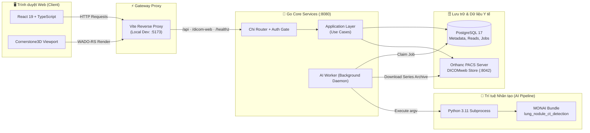

<div align="center">

# 🫁 Hệ Thống Hỗ Trợ Bác Sĩ Phát Hiện Nốt Phổi Trên Ảnh CT


---

[](https://go.dev/)
[](https://react.dev/)
[](https://www.typescriptlang.org/)
[](https://www.python.org/)
[](https://www.postgresql.org/)
[](https://www.cornerstonejs.org/)

<br/>

> [!CAUTION]
> **⚕️ Tuyên bố Y khoa (Medical Disclaimer):**  
> Đây là sản phẩm **Đồ án cơ sở — Proof of Concept (PoC)** phục vụ mục đích nghiên cứu học thuật. Hệ thống **không phải thiết bị y tế**, **không dùng để chẩn đoán lâm sàng** và **không thay thế quyết định chuyên môn của bác sĩ**. Mọi gợi ý từ AI chỉ mang tính chất tham khảo.

</div>

---

## 📑 Mục Lục

- [1. Mô tả dự án](#1-mô-tả-dự-án)
  - [Quy trình Second Reader](#-quy-trình-second-reader)
  - [Chức năng đã triển khai](#-chức-năng-đã-triển-khai)
  - [Chưa thuộc phạm vi](#-chưa-thuộc-phạm-vi)
- [2. Kiến trúc hệ thống](#2-kiến-trúc-hệ-thống)
  - [Sơ đồ tổng quan](#-sơ-đồ-tổng-quan)
  - [Phân tầng Clean Architecture (Backend)](#-phân-tầng-clean-architecture-backend)
- [3. Cấu trúc Repository](#3-cấu-trúc-repository)
- [4. Yêu cầu môi trường](#4-yêu-cầu-môi-trường)
- [5. Cấu hình biến môi trường](#5-cấu-hình-biến-môi-trường)
  - [Biến bắt buộc](#biến-bắt-buộc)
  - [Biến tùy chọn](#biến-tùy-chọn)
  - [Thiết lập nhanh (PowerShell)](#thiết-lập-nhanh-powershell)
- [6. Hướng dẫn cài đặt Native (Khuyến nghị)](#6-hướng-dẫn-cài-đặt-native-khuyến-nghị)
  - [6.1. PostgreSQL & Migration](#61-postgresql--migration)
  - [6.2. Build và khởi chạy Backend](#62-build-và-khởi-chạy-backend)
  - [6.3. Quản lý tài khoản bác sĩ (userctl)](#63-quản-lý-tài-khoản-bác-sĩ-userctl)
  - [6.4. Môi trường Python AI Worker](#64-môi-trường-python-ai-worker)
  - [6.5. Tải MONAI Bundle Trọng số](#65-tải-monai-bundle-trọng-số)
  - [6.6. Khởi chạy Frontend](#66-khởi-chạy-frontend)
- [7. Hướng dẫn sử dụng](#7-hướng-dẫn-sử-dụng)
- [8. Kiểm thử & Đánh giá chất lượng](#8-kiểm-thử--đánh-giá-chất-lượng)
- [9. Docker Compose (Tùy chọn phụ)](#9-docker-compose-tùy-chọn-phụ)
- [10. Cơ chế an toàn & Bảo mật](#10-cơ-chế-an-toàn--bảo-mật)
- [11. Giấy phép & Dữ liệu](#11-giấy-phép--dữ-liệu)

---

## 1. Mô tả dự án

Ảnh chụp cắt lớp vi tính lồng ngực (Chest CT) thường bao gồm hàng trăm lát cắt với các nốt phổi có kích thước rất nhỏ (chỉ vài milimét), dễ bị bỏ sót trong quá trình đọc phim thủ công căng thẳng.

Dự án xây dựng một nền tảng web hoàn chỉnh hỗ trợ bác sĩ theo mô hình **Second Reader** (người đọc thứ hai):

### 🔄 Quy trình Second Reader

```text
┌──────────────────────┐      ┌─────────────────┐      ┌─────────────────────────┐      ┌──────────────────────┐
│  Bác sĩ đọc độc lập  │ ───► │  Khóa bản đọc   │ ───► │  Hệ thống mở gợi ý AI   │ ───► │ Bác sĩ chốt kết quả  │
│ (Initial Read & Đo)  │      │  (Submit & Lock)│      │  (Review & Đối chiếu)   │      │ (Final Read Lock)    │
└──────────────────────┘      └─────────────────┘      └─────────────────────────┘      └──────────────────────┘
```

> [!IMPORTANT]
> **Nguyên tắc cốt lõi về Đạo đức & Y tế:**
> 1. AI **tuyệt đối không được tiết lộ** trước khi bản đọc độc lập bị khóa, nhằm loại bỏ hoàn toàn thiên kiến xác nhận (confirmation bias).
> 2. Bác sĩ luôn giữ quyền phán quyết cuối cùng; bác sĩ vẫn hoàn tất ca bình thường ngay cả khi AI đang chờ, đang chạy hoặc gặp sự cố.

---

### ✅ Chức năng đã triển khai

| Nhóm chức năng | Chi tiết kỹ thuật |
| :--- | :--- |
| 🔐 **Xác thực an toàn** | Đăng nhập mã PIN 8 chữ số; Session cookie `nr_session` (`HttpOnly`, `SameSite=Strict`, thời hạn 8 giờ); Giới hạn tốc độ (Throttling) 5 lần thất bại / 15 phút. |
| 📥 **Tiếp nhận ca chụp** | Hỗ trợ tải lên file `.dcm`, DICOM không phần mở rộng, thư mục phân cấp, file nén `.zip`, `.tar`, `.tgz`; Tự động kiểm tra tính phù hợp của Series CT trước khi tạo ca. |
| 🩺 **CT Viewer chuyên dụng** | Tích hợp **Cornerstone3D** hiển thị Axial Stack: cuộn lát mượt mà, điều chỉnh Window/Level (W/L), phóng to/thu nhỏ (Zoom), công cụ đo kích thước nốt (`LengthTool`); Hệ thống phím tắt nhanh: `←` / `→` (chuyển lát), `W` (window/level), `Z` (zoom), `M` (đo). |
| 📝 **Đọc độc lập** | Tự động lưu bản nháp toàn danh sách (whole-list autosave), nộp và khóa bản đọc; PostgreSQL Triggers ngăn chặn mọi hành vi chỉnh sửa sau khi đã khóa. |
| ⚙️ **AI Job Worker** | Tiến trình nền theo vòng đời backend server, cơ chế claim job tuần tự, gọi mô hình Python/MONAI thông qua argv độc lập, ghi nhận kết quả vào `ai_jobs`. |
| 🔍 **AI Review & Chốt ca** | Chỉ mở thông tin AI sau khi khóa bản đọc độc lập; Giao diện hỗ trợ bác sĩ duyệt (chấp nhận/bỏ qua) từng ứng viên nốt; Lưu bản đọc cuối và khóa hoàn tất ca. |
| 🌐 **Hạ tầng & Dịch vụ** | Endpoint kiểm tra sức khỏe (`/healthz`) theo dõi Backend, PostgreSQL và Orthanc; Proxy DICOMweb an toàn (Read-only QIDO-RS/WADO-RS) tích hợp xác thực. |

---

### 🚧 Chưa thuộc phạm vi

> [!NOTE]
> - Chưa hỗ trợ chữ ký số / ký báo cáo lâm sàng chính thức; hiện tại mỗi ca thuộc quyền sở hữu của một tài khoản đọc độc lập.
> - **Overlay glyph ứng viên AI chưa được nối vào viewer** (đang chờ kiểm chứng độ chuẩn xác không gian tọa độ 3D); hiện tại hệ thống hỗ trợ điều hướng tự động tới lát cắt gần nhất với tọa độ nốt AI phát hiện.
> - **Suy luận AI thật chưa được đo đạc chính thức** trên phần cứng GPU chuyên dụng: các chỉ số về độ nhạy/đặc hiệu, thời gian thực thi, mức tiêu thụ RAM/VRAM đều ở trạng thái *chưa kiểm chứng lâm sàng*. Hệ thống cam kết không dùng kết quả giả lập (mock data).
> - Chưa thực hiện đánh giá đầy đủ trên các tập dữ liệu chuẩn độc lập (LIDC-IDRI, LNDb); Chưa hỗ trợ định dạng NIfTI/NRRD hay file nén RAR/7z; Chưa tích hợp WebSocket thời gian thực.

---

## 2. Kiến trúc hệ thống

### 🌐 Sơ đồ tổng quan



> [!TIP]
> **Đảm bảo tính cô lập và bảo mật:**  
> Trình duyệt **chỉ** giao tiếp qua Go Backend. Thông tin đăng nhập, kết nối nội bộ PostgreSQL và Orthanc PACS được bảo vệ tuyệt đối trong mạng máy chủ.

---

### 🏛️ Phân tầng Clean Architecture (Backend)

Backend tuân thủ nghiêm ngặt nguyên lý **Clean Architecture** với việc tiêm phụ thuộc thủ công (Manual Dependency Injection):

| Tầng kiến trúc | Gói thư mục | Trách nhiệm chính |
| :--- | :--- | :--- |
| **Composition Root** | `backend/cmd/server` | Khởi tạo cấu hình, kết nối cơ sở dữ liệu, tiêm phụ thuộc adapter vào use case, định tuyến router và graceful shutdown. |
| **Application (Use Cases)** | `backend/internal/application/*` | Triển khai logic nghiệp vụ cốt lõi: `health`, `caseimport`, `initialread`, `finalread`, `aijob`, `auth`. Hoàn toàn độc lập với database hay web framework. |
| **Infrastructure (Adapters)** | `backend/internal/infrastructure/*` | Hiện thực hóa các interface (ports): `postgres`, `orthanc`, `python`, `upload`, `authcrypto`. |
| **Transport** | `backend/internal/transport/http` | Xử lý HTTP request bằng Chi router, chuyển đổi DTO, ánh xạ lỗi chuẩn RESTful, kiểm soát phiên người dùng (session gate). |

---

## 3. Cấu trúc Repository

```
📂 AI Project/
├── 🔧 backend/                 # Mã nguồn Backend viết bằng Go (API, worker, migration)
│   ├── cmd/                    # Entrypoints: server (API), migrate (DDL), userctl (CLI admin)
│   ├── internal/               # Các tầng Clean Architecture: application, infrastructure, transport
│   └── migrations/             # Các tệp SQL migration (00001 -> 00005) được nhúng trực tiếp
├── 🖥️ frontend/                # Ứng dụng Web Single-Page viết bằng React 19 + TypeScript
│   ├── src/                    # UI Components, Cornerstone3D Viewer, Initial/Final Read modules
│   └── tests/                  # Kiểm thử logic hình học và workflow chạy qua Node.js native test runner
├── 🐍 services/                # Module AI Python đóng gói (MONAI bundle runner)
│   ├── src/module_ai/          # Package thực thi suy luận nốt phổi
│   ├── tests/                  # Bộ kiểm thử đơn vị Python (135 tests)
│   ├── ai-bundle-manifest.json # Bảng băm kiểm tra tính toàn vẹn của mô hình MONAI
│   └── requirements-ai-cpu.txt # Khóa phiên bản thư viện AI cho môi trường CPU
├── 🐳 infra/                   # Cấu hình phụ trợ: docker-compose.yml và orthanc.json
├── 📄 .env.example             # Tệp mẫu cấu hình môi trường cho Docker Compose
└── 📖 README.md                # Tài liệu hướng dẫn sử dụng và triển khai dự án
```

> [!NOTE]
> **Các tài nguyên không nằm trong Git (cần chuẩn bị riêng):**  
> Trọng số mô hình (`model.pt`, ~83.7 MB), các tệp ảnh CT DICOM thực tế, biến môi trường nhạy cảm, thư mục `node_modules`, môi trường ảo Python `.venv` và các tệp binary đã biên dịch.

---

## 4. Yêu cầu môi trường

| Thành phần | Phiên bản yêu cầu | Mục đích & Ghi chú |
| :--- | :--- | :--- |
| **Go** | `>= 1.27` | Biên dịch Backend API, Migration tool và User Admin CLI. |
| **Node.js** | `>= 24.x` | Chạy Frontend dev server & thực thi kiểm thử bằng `node:test`. |
| **Python** | `3.11.x` | Môi trường tương thích tối ưu cho PyTorch và MONAI framework. |
| **PostgreSQL** | `17.x` | Lưu trữ quan hệ; Hỗ trợ các trigger khóa dữ liệu đọc phim. |
| **Orthanc PACS** | `>= 1.13` | PACS server mã nguồn mở, yêu cầu cài đặt sẵn plugin **DICOMweb**. |
| **Phần cứng GPU** | *(Tùy chọn)* | Hỗ trợ CUDA nếu có card NVIDIA; Mặc định có thể chạy trên CPU qua cấu hình. |

---

## 5. Cấu hình biến môi trường

> [!IMPORTANT]
> Backend **chỉ đọc biến môi trường từ hệ điều hành (Process Environment)**, không đọc trực tiếp từ tệp `.env`.  
> Tệp `.env.example` chỉ sử dụng cho triển khai Docker Compose.

### Biến bắt buộc

| Tên biến | Kiểu dữ liệu | Ý nghĩa |
| :--- | :--- | :--- |
| `POSTGRES_HOST`, `POSTGRES_PORT` | `string`, `number` | Địa chỉ IP và cổng của máy chủ PostgreSQL (vd: `127.0.0.1`, `5432`). |
| `POSTGRES_DB`, `POSTGRES_USER`, `POSTGRES_PASSWORD` | `string` | Tên database, tài khoản và mật khẩu truy cập PostgreSQL. |
| `ORTHANC_URL` | `URL` | Địa chỉ gốc của Orthanc PACS (vd: `http://127.0.0.1:8042`). |
| `ORTHANC_USER`, `ORTHANC_PASSWORD` | `string` | Tài khoản Basic Auth cấu hình trong Orthanc. |
| `AUTH_PIN_PEPPER` | `base64url` | Chuỗi bí mật 32 byte (unpadded base64url) dùng băm PIN; Dùng chung giữa `server` và `userctl`. |
| `AI_PYTHON` | `filepath` | Đường dẫn tuyệt đối tới tệp thực thi `python.exe` trong môi trường ảo chứa MONAI. |
| `AI_BUNDLE_DIR` | `dirpath` | Đường dẫn tuyệt đối tới thư mục bundle trọng số MONAI. |
| `AI_JOB_DIR` | `dirpath` | Thư mục ghi tạm các job suy luận (cần quyền ghi, không trùng `AI_BUNDLE_DIR`). |
| `UPLOAD_DIR` | `dirpath` | Thư mục lưu trữ tạm thời các file DICOM tải lên trước khi nạp vào PACS. |

### Biến tùy chọn

| Tên biến | Mặc định | Mô tả |
| :--- | :--- | :--- |
| `HTTP_ADDR` | `:8080` | Địa chỉ lắng nghe của backend; Trên môi trường native nên dùng `127.0.0.1:8080`. |
| `AI_DEVICE` | `cuda` | Thiết bị suy luận: `cpu`, `cuda`, hoặc `cuda:N` (không tự động fallback nếu chọn sai). |
| `AI_TIMEOUT` | `15m` | Thời gian tối đa cho phép một tiến trình suy luận AI thực thi. |
| `AUTH_COOKIE_SECURE` | `false` | Cờ `Secure` của cookie. Bắt buộc đặt `true` khi triển khai trên môi trường có HTTPS. |
| `BACKEND_URL` | `http://127.0.0.1:8080` | Cấu hình proxy cho Vite dev server phía frontend. |

### Khởi tạo chuỗi Pepper

Chạy lệnh Node.js sau để tạo một mã Pepper hợp lệ:

```bash
node -e "console.log(require('crypto').randomBytes(32).toString('base64url'))"
```

> [!WARNING]
> Nếu làm mất hoặc thay đổi `AUTH_PIN_PEPPER`, **tất cả mã PIN của bác sĩ đã tạo sẽ không thể xác thực được nữa** và bắt buộc phải thiết lập lại bằng lệnh `userctl rotate`.

### Thiết lập nhanh (PowerShell)

```powershell
# Thiết lập kết nối dịch vụ
$env:HTTP_ADDR            = "127.0.0.1:8080"
$env:POSTGRES_HOST        = "127.0.0.1"; $env:POSTGRES_PORT = "5432"
$env:POSTGRES_DB          = "nodule"; $env:POSTGRES_USER = "nodule"; $env:POSTGRES_PASSWORD = "<mat_khau_db>"
$env:ORTHANC_URL          = "http://127.0.0.1:8042"
$env:ORTHANC_USER         = "nodule"; $env:ORTHANC_PASSWORD = "<mat_khau_orthanc>"

# Thiết lập an toàn & xác thực
$env:AUTH_PIN_PEPPER      = "<chuoi_32_byte_base64url_vua_tao>"
$env:AUTH_COOKIE_SECURE   = "false"

# Thiết lập đường dẫn AI và Thư mục làm việc
$env:AI_PYTHON            = "D:\AI Project\services\.venv-ai\Scripts\python.exe"
$env:AI_BUNDLE_DIR        = "D:\AI Project\bundle\lung_nodule_ct_detection\0.6.11"
$env:AI_JOB_DIR           = "C:\Temp\nodule_jobs"
$env:UPLOAD_DIR           = "C:\Temp\nodule_uploads"
```

---

## 6. Hướng dẫn cài đặt Native (Khuyến nghị)

> Khuyến nghị chạy trực tiếp trên hệ điều hành chủ để có hiệu năng xử lý ảnh tốt nhất.

### 6.1. PostgreSQL & Migration

Khởi tạo schema và các trigger khóa bản đọc:

```bash
cd backend

# Chạy migration áp dụng các tệp từ 00001 đến 00005
go run ./cmd/migrate up

# Kiểm tra phiên bản migration hiện tại (kỳ vọng: 5)
go run ./cmd/migrate version
go run ./cmd/migrate status
```

---

### 6.2. Build và khởi chạy Backend

```powershell
cd backend

# Kiểm tra cú pháp và chất lượng mã nguồn
go build ./...
go vet ./...

# Tạo thư mục binary và biên dịch
$bin = Join-Path $env:LOCALAPPDATA "nodule-reader\bin"
New-Item -ItemType Directory -Force -Path $bin | Out-Null
go build -o "$bin\" ./cmd/server ./cmd/userctl

# Khởi động Backend Server
& "$bin\server.exe"
```

> [!TIP]
> Backend hỗ trợ khởi động ở chế độ *Degraded* (suy giảm) khi database hoặc PACS chưa sẵn sàng. Bạn có thể kiểm tra trạng thái tại `http://127.0.0.1:8080/healthz`.

---

### 6.3. Quản lý tài khoản bác sĩ (userctl)

Sử dụng công cụ CLI quản trị chuyên dụng `userctl` để cấp phát tài khoản:

```powershell
$bin = Join-Path $env:LOCALAPPDATA "nodule-reader\bin"

# 1. Tạo tài khoản mới (Mã PIN chỉ hiển thị MỘT LẦN DUY NHẤT)
& "$bin\userctl.exe" create --name "BS. Nguyen Van A"

# 2. Liệt kê danh sách bác sĩ trong hệ thống
& "$bin\userctl.exe" list

# 3. Đổi mã PIN mới cho bác sĩ
& "$bin\userctl.exe" rotate --id <user_id>

# 4. Thu hồi / Vô hiệu hóa tài khoản
& "$bin\userctl.exe" revoke --id <user_id>
```

---

### 6.4. Môi trường Python AI Worker

Thiết lập môi trường ảo cô lập và cài đặt các thư viện cần thiết:

```powershell
cd services

# Tạo virtualenv với Python 3.11
py -3.11 -m venv .venv-ai

# Nâng cấp công cụ đóng gói
.\.venv-ai\Scripts\python.exe -m pip install --upgrade "setuptools==84.0.0" "wheel==0.48.0"

# Cài đặt thư viện AI với cơ chế kiểm tra mã băm bảo mật (dành cho CPU)
.\.venv-ai\Scripts\python.exe -m pip install --require-hashes -r requirements-ai-cpu.txt

# Cài đặt gói package cục bộ ở chế độ editable
.\.venv-ai\Scripts\python.exe -m pip install --no-build-isolation -e .

# Kiểm tra tính toàn vẹn phụ thuộc
.\.venv-ai\Scripts\python.exe -m pip check
```

Kiểm tra CLI suy luận nốt:

```powershell
.\.venv-ai\Scripts\python.exe -c "import module_ai; print(module_ai.__file__)"
.\.venv-ai\Scripts\python.exe -m module_ai.infer --help
```

> [!WARNING]
> **Lưu ý kỹ thuật:**  
> Mã nguồn Python trong `services/src/module_ai` sử dụng tên package `module_ai`. Tuy nhiên backend hiện gọi lệnh `python -m nodule_ai.infer` (`backend/internal/infrastructure/python/runner.go`). Cần đảm bảo alias hoặc đồng bộ định danh để worker tự động kích hoạt. Các quy trình nạp ca, xem ảnh CT và đọc độc lập trên web hoàn toàn không bị ảnh hưởng.

---

### 6.5. Tải MONAI Bundle Trọng số

Sử dụng đoạn mã Python tự động sau để tải 19 tệp thành phần của mô hình (bao gồm `model.pt` dung lượng 83.7 MB) và kiểm tra tính toàn vẹn bằng SHA-256:

```powershell
cd services
@'
import hashlib, json, shutil, urllib.request
from pathlib import Path

# Đặt thư mục đích lưu bundle
BUNDLE_ROOT = Path(r"D:\AI Project\bundle")
manifest = json.loads(Path("ai-bundle-manifest.json").read_text(encoding="utf-8"))
dest = BUNDLE_ROOT / manifest["bundle_name"] / manifest["bundle_version"]

def sha256(path):
    digest = hashlib.sha256()
    with path.open("rb") as handle:
        for block in iter(lambda: handle.read(1 << 20), b""):
            digest.update(block)
    return digest.hexdigest()

for item in manifest["files"]:
    target = dest / item["path"]
    target.parent.mkdir(parents=True, exist_ok=True)
    if target.is_file() and sha256(target) == item["digest"]:
        print("[OK] Da ton tai & hop le:", item["path"])
        continue
    print("[DOWNLOAD] Dang tai:", item["path"])
    with urllib.request.urlopen(item["source"], timeout=300) as response, target.open("wb") as output:
        shutil.copyfileobj(response, output)
    if sha256(target) != item["digest"]:
        raise SystemExit("[LOI] Sai lech ma bam (checksum mismatch): " + item["path"])

print("==> Da chuan bi xong bundle tai:", dest)
'@ | .\.venv-ai\Scripts\python.exe -
```

---

### 6.6. Khởi chạy Frontend

```bash
cd frontend

# Cài đặt chính xác các phụ thuộc theo lockfile
npm ci

# Khởi chạy máy chủ phát triển
npm run dev -- --host 127.0.0.1
```

Truy cập hệ thống tại: **`http://127.0.0.1:5173`**
- Giao diện Dashboard (Quản lý và tải lên ca chụp): `/`
- Không gian làm việc đọc phim 3 bước: `/?case=<case_id>`

---

## 7. Hướng dẫn sử dụng

```text
 Bước 1               Bước 2               Bước 3               Bước 4               Bước 5
┌─────────────┐     ┌─────────────┐     ┌─────────────┐     ┌─────────────┐     ┌─────────────┐
│  Đăng nhập  │ ──► │ Tải lên ca  │ ──► │Đọc độc lập  │ ──► │Xem gợi ý AI │ ──► │  Chốt ca    │
│  (Mã PIN)   │     │  (DICOM CT) │     │ (Lưu/Khóa)  │     │(Duyệt nốt)  │     │(Finalize)   │
└─────────────┘     └─────────────┘     └─────────────┘     └─────────────┘     └─────────────┘
```

1. **Đăng nhập:** Nhập mã PIN 8 số được cấp từ công cụ `userctl`.
2. **Tiếp nhận ca:** Chọn tệp/thư mục ảnh CT. Hệ thống kiểm tra chất lượng lát cắt, độ dày lát và tính toàn vẹn trước khi cho phép tạo ca.
3. **Đọc độc lập:**
   - Dùng chuột cuộn lát cắt hoặc dùng phím tắt `←` / `→`.
   - Điều chỉnh độ tương phản mô mềm/phổi với phím `W`.
   - Nhấn `M` để đo đường kính nốt nghi ngờ trực tiếp trên hình ảnh.
   - Hệ thống tự động lưu nháp. Sau khi hoàn thành, nhấn **Nộp và khóa** *(Bản đọc sẽ bị khóa vĩnh viễn)*.
4. **Xem gợi ý AI:** Hệ thống mở khóa dữ liệu phân tích từ mô hình. Bác sĩ xem xét từng tọa độ nốt AI gợi ý và chọn **Chấp nhận** hoặc **Bỏ qua**.
5. **Chốt kết quả:** Bổ sung kết luận cuối cùng và nhấn **Hoàn tất ca** để chuyển sang chế độ lưu trữ chỉ đọc.

### Giới hạn Upload dữ liệu

| Tiêu chuẩn kiểm soát | Giới hạn |
| :--- | :--- |
| Dung lượng tối đa sau giải nén | **4 GiB** |
| Kích thước tối đa mỗi tệp DICOM | **64 MiB** |
| Số lượng tệp tối đa trong một đợt | **10.000 tệp** |
| Số phần tử (entries) trong tệp nén | **20.000 mục** |
| Tiêu chí an toàn tệp nén | Ngăn chặn Path Traversal (`../`), Symlink, nén lồng nhau và tệp mã hóa. |

---

## 8. Kiểm thử & Đánh giá chất lượng

Hệ thống được thiết kế theo hướng đảm bảo chất lượng với các bộ kiểm thử tự động toàn diện:

### Chạy toàn bộ Test Suites

```bash
# 1. Backend Go Tests (Unit & Logic validation)
cd backend && go test ./...

# 2. Frontend Typecheck & Build
cd frontend && npm run typecheck
cd frontend && npm run build

# 3. Frontend Unit Tests (Kiểm thử xác thực, hình học & luồng đọc phim)
cd frontend
npm run test:auth
npm run test:geometry
npm run test:initialread
npm run test:upload

# 4. Python AI Pipeline Tests
cd services
.\.venv-ai\Scripts\python.exe -m unittest discover -s tests
```

> [!NOTE]
> - Kết quả bộ test Python: **135 test thành công (PASS), 6 test tạm bỏ qua (SKIP)**.
> - Các bài kiểm thử đóng vai trò chứng minh **hợp đồng phần mềm (Software Contracts)**: tính toàn vẹn dữ liệu, các bất biến DB, giao thức API và độ chuẩn xác của các phép biến đổi hình học không gian.

---

## 9. Docker Compose (Tùy chọn phụ)

Dự án cung cấp cấu hình Docker Compose cho mục đích triển khai nhanh các thành phần phụ trợ:

```bash
# 1. Sao chép và cấu hình biến môi trường
cp .env.example .env

# 2. Khởi chạy toàn bộ dịch vụ phụ trợ
docker compose --env-file .env -f infra/docker-compose.yml up --build -d --wait
```

> [!WARNING]
> **Lưu ý khi dùng Docker:**  
> - Cấu hình Compose hiện tại tập trung vào việc dựng nhanh PostgreSQL và Orthanc PACS. Tiến trình AI worker khuyến nghị chạy Native trên máy trạm để tận dụng tối đa GPU.
> - Trên hệ điều hành Windows, Docker Desktop yêu cầu phải kích hoạt tính năng **WSL2**.

---

## 10. Cơ chế an toàn & Bảo mật

| Tiêu chí | Cơ chế đảm bảo |
| :--- | :--- |
| **Kiểm soát truy cập** | Toàn bộ các API nghiệp vụ và DICOMweb proxy đều yêu cầu phiên đăng nhập hợp lệ. Chỉ có `/healthz`, `/api/auth/login` và `/api/auth/session` được phép truy cập công khai. |
| **Cách ly dữ liệu AI** | Dữ liệu gợi ý từ AI (kể cả số lượng nốt phát hiện) được phong tỏa hoàn toàn ở tầng Backend; Mọi yêu cầu truy xuất sớm sẽ bị chặn với mã lỗi `403 INITIAL_READ_REQUIRED`. |
| **Bất biến sau khi khóa** | Sau khi bác sĩ bấm nộp, trạng thái bản đọc được khóa đồng thời ở cả **Application Logic** và **Database Trigger (PostgreSQL)**, ngăn ngừa hoàn toàn việc can thiệp sửa đổi qua API hay runtime SQL trực tiếp. |
| **Phân quyền sở hữu ca** | Mỗi ca chụp thuộc về duy nhất bác sĩ đang thực hiện. Người dùng khác truy cập sẽ nhận phản hồi `403 CASE_ASSIGNED_TO_ANOTHER_USER`. |
| **Bảo vệ quyền riêng tư bệnh nhân** | Toàn bộ dữ liệu CT thử nghiệm đưa vào hệ thống **bắt buộc phải được khử định danh (Anonymized)**, loại bỏ triệt để thông tin cá nhân (PII). |

---

## 11. Giấy phép & Dữ liệu

- Mã nguồn dự án được xây dựng phục vụ nghiên cứu trong khuôn khổ Đồ án Cơ sở ngành CNTT — Đại học Phenikaa.
- Mô hình AI sử dụng bundle `lung_nodule_ct_detection` phát triển bởi **Project MONAI** và huấn luyện trên các tập dữ liệu công khai (LIDC-IDRI, LUNA16). Vui lòng tham khảo chi tiết giấy phép tại `services/ai-bundle-manifest.json` và tài liệu chính thức của MONAI trước khi phân phối thương mại.

---

<div align="center">

**Phenikaa University**  
*Hà Nội, Việt Nam*

</div>
