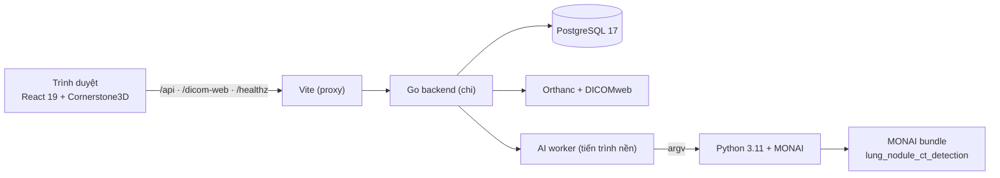

# Hệ thống hỗ trợ bác sĩ phát hiện nốt phổi trên ảnh CT

> **Đồ án cơ sở — Proof of Concept.** Hệ thống **không phải thiết bị y tế**, không dùng để chẩn đoán
> lâm sàng và không thay thế quyết định của bác sĩ. Kết quả AI chỉ mang tính hỗ trợ nghiên cứu.

## 1. Mô tả dự án

Ảnh CT lồng ngực có thể gồm hàng trăm lát cắt, mỗi nốt phổi chỉ vài milimét và dễ bị bỏ sót khi đọc
thủ công. Đồ án xây dựng một hệ thống web hỗ trợ quy trình đọc theo mô hình **second reader**:

```text
Bác sĩ đọc độc lập → khóa bản đọc → hệ thống tiết lộ gợi ý AI → bác sĩ chốt kết quả cuối
```

AI **không** được tiết lộ trước khi bản đọc độc lập bị khóa, và bác sĩ vẫn hoàn tất ca được khi AI
đang chờ, đang chạy hoặc thất bại.

### Chức năng đã triển khai

| Nhóm | Nội dung |
| --- | --- |
| Xác thực | Đăng nhập PIN 8 chữ số; phiên `nr_session` (`HttpOnly`, `SameSite=Strict`, 8 giờ); throttling 5 lần sai / 15 phút |
| Nhập ca | Upload `.dcm`, DICOM không đuôi, thư mục lồng nhau, ZIP/TAR/TGZ; kiểm tra series trước khi tạo ca |
| Viewer | Cornerstone3D axial stack: cuộn lát, window/level, zoom, đo nốt; phím `←/→/W/Z/M` |
| Đọc độc lập | Tự động lưu nháp (whole-list), nộp và khóa bản đọc; trigger PostgreSQL chặn sửa sau khóa |
| AI worker | Worker nền vòng đời server, claim job tuần tự, gọi Python/MONAI qua argv, ghi `ai_jobs` |
| AI review | Chỉ tiết lộ sau khi khóa; bác sĩ chấp nhận/bỏ qua từng ứng viên; bản đọc cuối và hoàn tất ca |
| Hạ tầng | Health check backend/PostgreSQL/Orthanc; DICOMweb proxy chỉ đọc có xác thực |

### Chưa thuộc phạm vi

- Chưa ký báo cáo lâm sàng; chưa có nhiều bác sĩ cùng đọc một ca (mỗi ca thuộc một tài khoản).
- **Overlay glyph ứng viên AI chưa được nối vào viewer** (chờ kiểm chứng tọa độ); hiện chỉ điều hướng tới lát gần nhất.
- **Suy luận AI thật chưa được đo** trên máy đủ GPU/RAM: độ chính xác, thời gian, RAM/VRAM và vị trí
  detector đều là `chưa kiểm chứng`. Không có kết quả giả thay thế.
- Chưa đánh giá trên tập held-out (LIDC-IDRI/LNDb), chưa hỗ trợ NIfTI/NRRD/RAR/7z, chưa có WebSocket.

## 2. Kiến trúc



Trình duyệt **chỉ** giao tiếp với backend. Credential PostgreSQL và Orthanc nằm hoàn toàn ở server.

Backend theo Clean Architecture với dependency injection thủ công:

| Tầng | Thư mục | Trách nhiệm |
| --- | --- | --- |
| Composition root | `backend/cmd/server` | cấu hình, adapter, router, graceful shutdown |
| Use case | `backend/internal/application/*` | `health`, `caseimport`, `initialread`, `finalread`, `aijob`, `auth` |
| Adapter | `backend/internal/infrastructure/*` | `postgres`, `orthanc`, `python`, `upload`, `authcrypto` |
| Transport | `backend/internal/transport/http` | chi router, DTO, ánh xạ lỗi, session gate |

## 3. Nội dung repository

| Đường dẫn | Nội dung |
| --- | --- |
| `backend/` | Go API, worker AI, `cmd/{server,migrate,userctl}`, migration nhúng, `sqlc.yaml` |
| `frontend/` | React/TypeScript UI, viewer Cornerstone3D, `tests/` chạy bằng `node:test` |
| `services/` | Python package `nodule_ai` (thư mục `services/src/module_ai`), CLI suy luận, `tests/`, lock dependency, `ai-bundle-manifest.json` |
| `infra/` | `docker-compose.yml` và `orthanc.json` (đường đóng gói phụ) |
| `.env.example` | Khuôn biến môi trường cho Docker Compose |

Không có trong repository (phải tải/cài riêng): **trọng số model** (`model.pt`, 83.7 MB), dữ liệu DICOM,
biến môi trường thật, `node_modules`, virtualenv, binary build.

Tài liệu thiết kế/runbook chi tiết (`docs/`) không bắt buộc để chạy; README này chứa đủ cấu hình và
các bước cài đặt.

## 4. Yêu cầu môi trường

| Thành phần | Phiên bản | Ghi chú |
| --- | --- | --- |
| Go | 1.27 | `go.mod` khai báo `go 1.27.0` |
| Node.js | 24 | `node:test` + `--experimental-strip-types` cho test frontend |
| Python | 3.11.x | `requires-python = ">=3.11,<3.12"` |
| PostgreSQL | 17 | extension không bắt buộc; chỉ cần role ứng dụng |
| Orthanc | 1.13 + plugin DICOMweb | bật `DicomWeb`, xác thực Basic |
| GPU | tùy chọn | `AI_DEVICE=cpu` vẫn chạy; CUDA cần wheel torch tương ứng |

Mọi service native nên nghe trên loopback. Trình duyệt không bao giờ truy cập Orthanc trực tiếp.

## 5. Cấu hình

Backend **chỉ đọc biến môi trường process**, không đọc `.env`. `.env.example` chỉ dùng cho đường
Docker Compose.

### Biến bắt buộc

| Biến | Ý nghĩa |
| --- | --- |
| `POSTGRES_HOST`, `POSTGRES_PORT`, `POSTGRES_DB`, `POSTGRES_USER`, `POSTGRES_PASSWORD` | kết nối PostgreSQL (`sslmode=disable` cho môi trường local) |
| `ORTHANC_URL`, `ORTHANC_USER`, `ORTHANC_PASSWORD` | Orthanc REST + DICOMweb |
| `AUTH_PIN_PEPPER` | base64url **không padding** của đúng 32 byte; dùng chung với `userctl` |
| `AI_PYTHON` | đường dẫn tuyệt đối tới interpreter có MONAI/torch |
| `AI_BUNDLE_DIR` | thư mục tuyệt đối của bundle, trỏ tới `.../lung_nodule_ct_detection/0.6.11` |
| `AI_JOB_DIR` | thư mục riêng tư, ghi được; **không** trùng `AI_BUNDLE_DIR` |
| `UPLOAD_DIR` | thư mục staging upload riêng tư, ghi được |

### Biến tùy chọn

| Biến | Mặc định | Ghi chú |
| --- | --- | --- |
| `HTTP_ADDR` | `:8080` | native nên đặt `127.0.0.1:8080` |
| `AI_DEVICE` | `cuda` | `cpu`, `cuda`, `cuda:N`; không tự fallback |
| `AI_TIMEOUT` | `15m` | timeout một job suy luận |
| `AUTH_COOKIE_SECURE` | `false` | **phải** `true` khi chạy sau HTTPS |
| `BACKEND_URL` | `http://127.0.0.1:8080` | chỉ dùng cho Vite dev server |

Tạo pepper:

```bash
node -e "console.log(require('crypto').randomBytes(32).toString('base64url'))"
```

Đổi hoặc mất `AUTH_PIN_PEPPER` sẽ làm **mọi PIN cũ không tra cứu được** — phải rotate lại từng user.

### Nạp biến môi trường (PowerShell, native)

```powershell
$env:HTTP_ADDR="127.0.0.1:8080"
$env:POSTGRES_HOST="127.0.0.1"; $env:POSTGRES_PORT="5432"
$env:POSTGRES_DB="nodule"; $env:POSTGRES_USER="nodule"; $env:POSTGRES_PASSWORD="<secret>"
$env:ORTHANC_URL="http://127.0.0.1:8042"
$env:ORTHANC_USER="nodule"; $env:ORTHANC_PASSWORD="<secret>"
$env:AUTH_PIN_PEPPER="<32-byte base64url>"
$env:AUTH_COOKIE_SECURE="false"
$env:AI_PYTHON="<repo>\services\.venv-ai\Scripts\python.exe"
$env:AI_BUNDLE_DIR="<private>\bundle\lung_nodule_ct_detection\0.6.11"
$env:AI_JOB_DIR="<private>\jobs"
$env:UPLOAD_DIR="<private>\uploads"
```

## 6. Cài đặt native

Thứ tự dưới đây là đường chạy đầy đủ. Chạy lệnh trong thư mục được ghi ở mỗi bước.

### 6.1. PostgreSQL, migration

Tạo database và role ứng dụng (role này không cần quyền superuser cho runtime):

```bash
cd backend
go run ./cmd/migrate up       # áp migration 00001..00005 (nhúng trong binary)
go run ./cmd/migrate version  # kỳ vọng: 5
go run ./cmd/migrate status
```

`cmd/migrate` chỉ chạy DDL và chỉ đọc `POSTGRES_*`.

### 6.2. Build và chạy backend

Xuất binary ra thư mục riêng ngoài repo (không tạo file chưa track trong working tree):

```powershell
cd backend
go build ./...
go vet ./...
$bin = Join-Path $env:LOCALAPPDATA "nodule-reader\bin"
New-Item -ItemType Directory -Force -Path $bin | Out-Null
go build -o "$bin\" ./cmd/server ./cmd/userctl
& "$bin\server.exe"
```

Server khởi động kể cả khi PostgreSQL/Orthanc chưa sẵn sàng; `GET /healthz` trả `200 ok` hoặc
`503 degraded` kèm `checks.backend|postgres|orthanc`.

### 6.3. Tạo tài khoản bác sĩ

Dùng cùng `POSTGRES_*` và `AUTH_PIN_PEPPER` với backend:

```powershell
$bin = Join-Path $env:LOCALAPPDATA "nodule-reader\bin"
& "$bin\userctl.exe" create --name "Bác sĩ Demo"   # PIN chỉ in MỘT lần
& "$bin\userctl.exe" list
& "$bin\userctl.exe" rotate --id <id>
& "$bin\userctl.exe" revoke --id <id>
```

### 6.4. Môi trường Python cho AI

```powershell
cd services
py -3.11 -m venv .venv-ai
.\.venv-ai\Scripts\python.exe -m pip install --upgrade "setuptools==84.0.0" "wheel==0.48.0"
.\.venv-ai\Scripts\python.exe -m pip install --require-hashes -r requirements-ai-cpu.txt
.\.venv-ai\Scripts\python.exe -m pip install --no-build-isolation -e .
.\.venv-ai\Scripts\python.exe -m pip check
```

`requirements-ai-cpu.txt` khóa **wheel CPU cho Windows**. Trên Linux hoặc CUDA, cài `torch`/`torchvision`
từ index chính thức tương ứng rồi cài phần còn lại theo `pyproject.toml`.

Kiểm tra package và CLI đã cài:

```powershell
.\.venv-ai\Scripts\python.exe -c "import module_ai; print(module_ai.__file__)"
.\.venv-ai\Scripts\python.exe -m module_ai.infer --help
```

> **Hiện trạng cần biết:** thư mục package là `services/src/module_ai` và bộ `services/tests/` đã import
> `module_ai`, nhưng backend vẫn gọi `python -m nodule_ai.infer`
> (`backend/internal/infrastructure/python/runner.go`). Vì vậy CLI chạy tay được nhưng **worker AI chưa
> chạy được** cho tới khi tên trong backend và tên thư mục package được thống nhất. Upload, viewer và
> quy trình đọc ca không bị ảnh hưởng; AI thất bại vẫn không chặn bác sĩ chốt ca.

### 6.5. Tải MONAI bundle (không nằm trong Git)

Manifest `services/ai-bundle-manifest.json` ghi URL nguồn và SHA-256 cho cả 19 file, gồm
`models/model.pt` (83.7 MB). Tải và kiểm hash:

```powershell
cd services
@'
import hashlib, json, shutil, urllib.request
from pathlib import Path

BUNDLE_ROOT = Path(r"<private>\bundle")           # sửa đường dẫn
manifest = json.loads(Path("ai-bundle-manifest.json").read_text(encoding="utf-8"))
dest = BUNDLE_ROOT / manifest["bundle_name"] / manifest["bundle_version"]

def sha256(path):
    digest = hashlib.sha256()
    with path.open("rb") as handle:
        for block in iter(lambda: handle.read(1 << 20), b""):
            digest.update(block)
    return digest.hexdigest()

for item in manifest["files"]:
    target = dest / item["path"]
    target.parent.mkdir(parents=True, exist_ok=True)
    if target.is_file() and sha256(target) == item["digest"]:
        print("ok       ", item["path"])
        continue
    print("download ", item["path"])
    with urllib.request.urlopen(item["source"], timeout=300) as response, target.open("wb") as output:
        shutil.copyfileobj(response, output)
    if sha256(target) != item["digest"]:
        raise SystemExit("checksum mismatch: " + item["path"])

print("bundle ready:", dest)
'@ | .\.venv-ai\Scripts\python.exe -
```

Đặt `AI_BUNDLE_DIR` bằng đường dẫn `bundle ready` ở trên. Trọng số và license của bundle thuộc
Project-MONAI (dữ liệu LUNA16/LIDC-IDRI), không được phân phối lại trong repo.

### 6.6. Chạy frontend

```bash
cd frontend
npm ci
npm run dev -- --host 127.0.0.1
```

Mở <http://127.0.0.1:5173>: trang chủ là dashboard (upload + ca của bạn), `/?case=<id>` là workspace
ba bước. Vite proxy `/healthz`, `/api`, `/dicom-web` sang `BACKEND_URL`.

## 7. Sử dụng

1. Đăng nhập bằng PIN do `userctl` in ra.
2. Upload một thư mục/archive chứa **một** series CT phù hợp, kiểm tra thông tin series và mở ca.
3. Bước **Đọc độc lập**: cuộn lát, đo nốt, lưu nháp; bấm **Nộp và khóa** (không thể sửa sau đó).
4. Bước **Xem gợi ý AI**: trạng thái job tự cập nhật; chấp nhận hoặc bỏ qua từng ứng viên.
5. Bước **Chốt ca**: lưu bản đọc cuối và hoàn tất; ca chuyển sang chế độ chỉ đọc.

Giới hạn upload: **4 GiB** tổng sau giải nén, **64 MiB**/file DICOM, **10.000** file, **20.000** entry.
Archive bị kiểm tra path traversal, symlink, archive lồng nhau và archive mã hóa.

## 8. Kiểm thử

```bash
cd backend  && go test ./...
cd frontend && npm run typecheck && npm run build
cd frontend && npm run test:auth && npm run test:geometry
cd frontend && npm run test:initialread && npm run test:upload
```

```powershell
cd services
.\.venv-ai\Scripts\python.exe -m unittest discover -s tests
```

Bộ test Python: **135 test pass, 6 skip** (`services/tests/` import `module_ai`, khớp thư mục package).
Worker AI vẫn cần thống nhất tên module như ghi chú ở §6.4; Go và frontend không bị ảnh hưởng.

Test chứng minh **hợp đồng phần mềm** (API, hình học, bất biến DB, workflow). Chúng **không** chứng minh
độ chính xác phát hiện, thời gian suy luận hay VRAM — những số đó cần một lần chạy model thật.

Một số integration test PostgreSQL cần DSN thử nghiệm riêng; không chạy trên database đang giữ dữ liệu demo.

## 9. Docker Compose (phụ)

```bash
cp .env.example .env      # điền credential; .env bị git-ignore
docker compose --env-file .env -f infra/docker-compose.yml up --build -d --wait
```

Đường này **chưa đầy đủ**: image backend không chứa Python/AI và service backend không đặt
`AI_PYTHON`/`AI_BUNDLE_DIR`/`AI_JOB_DIR`, nên worker AI không chạy trong Compose. Frontend container
chạy Vite dev server, không phải static server production. Trên Windows, Docker cần WSL2.

## 10. Bảo mật

- Chỉ `GET /healthz`, `POST /api/auth/login`, `GET /api/auth/session` là công khai; mọi request `/api`
  và `/dicom-web` khác đều cần phiên, kể cả route/method không tồn tại.
- AI bị che hoàn toàn (kể cả số lượng) trước khi bản đọc đầu bị khóa: `403 INITIAL_READ_REQUIRED`.
- Bản đọc đã khóa bảo vệ ở **cả API và trigger PostgreSQL**; sửa sau khóa trả `409`.
- Ca thuộc một tài khoản; tài khoản khác nhận `403 CASE_ASSIGNED_TO_ANOTHER_USER`.
- Response không chứa PIN, hash, token, credential hay thông điệp lỗi nội bộ.
- Dữ liệu DICOM dùng cho demo phải được khử định danh trước khi đưa lên hệ thống.

## 11. Giấy phép và dữ liệu

Repository chưa công bố giấy phép chung cho toàn bộ mã nguồn. Bundle `lung_nodule_ct_detection` và các
bộ dữ liệu tham khảo (LIDC-IDRI, LUNA16) có giấy phép riêng — xem `data_license` trong
`services/ai-bundle-manifest.json` và license đi kèm bundle trước khi phân phối model, trọng số hoặc dữ liệu.
